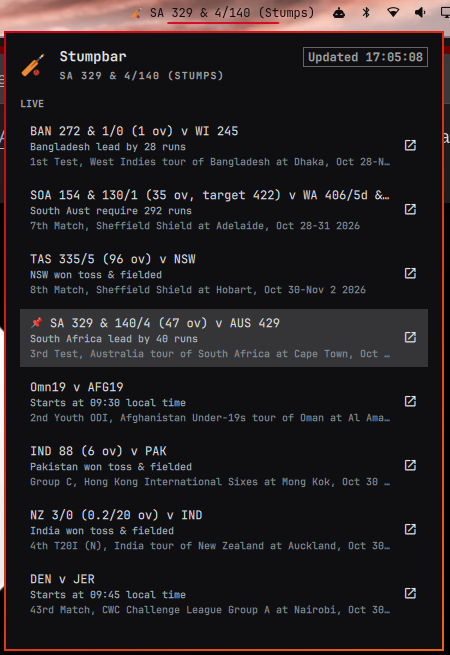

# Stumpbar for Linux

Live cricket scores in the [Omarchy](https://omarchy.org/) bar. A Linux port of
[Stumpbar](https://github.com/CalMac1983/stumpbar), the macOS menu bar app.



- The bar shows 🏏 plus the number of live matches, or the score of a match you pin.
- A pinned match shows the batting side as wickets/runs with over.ball, e.g. `AUS 7/282 (54.3)`,
  or the reason play has stopped, e.g. `(Stumps)`, `(Tea)`, `(Rain delay)`.
- Click it to open a panel listing **Live**, **Results** and **Upcoming** matches. Click a match
  to pin or unpin it; the ↗ button opens it on ESPNcricinfo.
- "International only" hides domestic/A-team games.
- **Wicket alerts** for the pinned match, with how the batter was out, e.g.
  *WICKET! AUS-A 7/277 (84.5) — Murphy b Kamboj · 33 (91)*.
- Refreshes every 15 seconds. Your pin and toggles are remembered across restarts.

| On the bar | Does |
|---|---|
| Left click | Open / close the panel |
| Right click | Refresh now |
| Middle click | Unpin |

In the panel, ↑/↓ move, Enter pins or toggles, `o` opens the selected match on ESPNcricinfo,
`r` refreshes, `u` unpins and Esc closes.

Scores come from ESPN's public (unofficial, undocumented) scoreboard feed — no API key needed, but it could change without notice.

## Install

Needs Omarchy with the Quickshell-based bar, `python3` and `notify-send` (both come with Omarchy).
No Python packages to install.

```sh
omarchy plugin add https://github.com/CalMac1983/stumpbar-linux.git --enable
```

It lands on the right of the bar; move it with e.g. `omarchy bar move calmac.stumpbar --section center`.
Update with `omarchy plugin update calmac.stumpbar`, remove with `omarchy plugin remove calmac.stumpbar`.

## How it works

| File | Role |
|---|---|
| `manifest.json` | Omarchy plugin manifest: a `service` plus a `bar-widget` |
| `Service.qml` | One instance per shell. Runs `stumpbar.py` and holds the latest scores |
| `Widget.qml` | The bar label and panel (one per monitor), all reading the shared service |
| `stumpbar.py` | Long-running helper: fetches scores, prints JSON state, sends wicket alerts |
| `scores.py`, `wickets.py` | Feed parsing and wicket detection, shared with the macOS app |

The service exists so a multi-monitor setup gets one helper and one copy of each wicket alert.
Settings live in `~/.local/state/stumpbar/settings.json`.

## Development

Run the helper by hand to see what the widget receives; type commands, Ctrl-D quits:

```sh
python3 stumpbar.py
pin <match id> | unpin | international on|off | alerts on|off | refresh
demo-wicket       # sample wicket alert, to check notifications
demo-dismissals   # one alert per dismissal type
```

To just print current scores: `python3 scores.py`.

To work on the plugin in place, link the checkout into Omarchy's plugin folder and enable it:

```sh
ln -s "$PWD" ~/.config/omarchy/plugins/calmac.stumpbar
omarchy plugin enable calmac.stumpbar
```

The shell doesn't notice edits made through the link, so reload after changing QML:
`omarchy-shell shell rescanPlugins`.

## Tests

```sh
pip install pytest
python -m pytest
```

## Licence

MIT — see [LICENSE](LICENSE) and [THIRD_PARTY_NOTICES.md](THIRD_PARTY_NOTICES.md).
